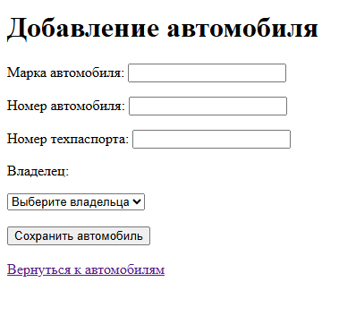
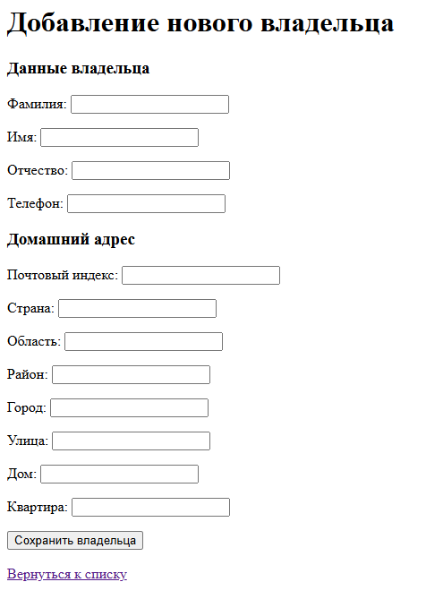
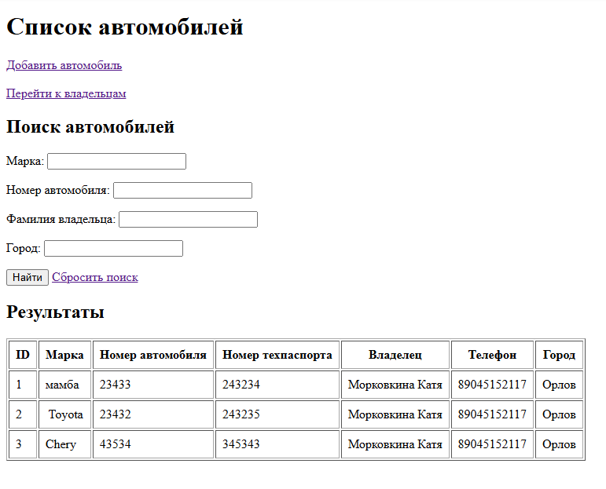
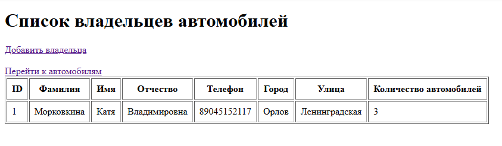

## Цель работы
Создание Spring-приложения с несколькими таблицами с использованием Java Persistent API

## Архитектура проекта
- **Стек:** Spring Boot 3, Maven Java, Spring Data JPA, Thymeleaf, Maven.
- **СУБД:** H2
- **Основные слои:** 
  - Repository (методы для получения данных)
  - Controller — обработка HTTP-запросов и управление страницами приложения.
  - Entity — описание сущностей и связей между таблицами.
  - DTO — передача данных и валидация пользовательского ввода.
  - Templates — HTML-страницы приложения на Thymeleaf.
- **Ключевые аннотации:** 
- @Entity
- @Table
- @Id
- @GeneratedValue
- @OneToOne
- @OneToMany
- @ManyToOne
- @JoinColumn
- @Query
- @Param 
- @Controller
- @GetMapping
- @PostMapping 
- @Valid
- @NotBlank
- @NotNull
- @Size
- @Pattern

## Алгоритм работы
- При запуске приложения Spring Boot инициализирует приложение и подключается к базе данных.
- Пользователь открывает список владельцев или автомобилей.
- Для добавления владельца заполняется форма с личными данными и адресом.
- Для добавления автомобиля заполняется форма с маркой, номером, техпаспортом и выбором владельца.
- Введённые данные проверяются с помощью Bean Validation.
- После успешной проверки данные сохраняются в базе данных через Spring Data JPA.
- Для автомобилей доступен поиск по марке, государственному номеру, фамилии владельца и городу проживания.
## Скриншоты работы приложения
  ### добавление автомобиля
  
  
  ### Добавление владельца
  
  
  ### Список автомобилей
  
  
  ### Список владельцев
  
